<p align="center">
  
</p>

<h3 align="center">Dos skills para que Claude optimice y toque una tienda Shopify que ya está vendiendo<br>como alguien que ya lo ha hecho antes.</h3>

<p align="center">
  <a href="LICENSE"></a>
  
  
  <a href="https://github.com/juancaaa11/claude-skills-shopify/stargazers"></a>
  <a href="https://instagram.com/juancaaa11"></a>
</p>

<p align="center">
  <b>Medir antes de tocar</b> · <b>cambios pequeños y reversibles</b> · <b>diseño, compra y medición intactos</b>
</p>

<br>

## Qué es esto

Lo aprendido optimizando dos tiendas reales, convertido en instrucciones que Claude carga solo cuando hacen falta. No
es teoría: cada regla responde a algo que se midió o a algo que salió mal.

| Skill | Para qué sirve | Se activa cuando dices… |
| --- | --- | --- |
| **`shopify-rendimiento`** | Optimizar la carga con método: línea base, causas, prioridad, cambios, antes y después, informe | «la ficha va lenta en móvil», «te pego los errores de PageSpeed», «súbeme la nota», «limpia el tema» |
| **`shopify-cambios-en-vivo`** | Tocar y publicar en una tienda abierta sin pisar lo que el dueño edita ni romper nada | «súbelo a live», «comprueba que todo funciona», «revísalo antes de lanzar la campaña» |

La primera se apoya en la segunda para verificar y publicar: van juntas.

<br>

<p align="center">
  
</p>

<p align="center">
  
</p>

<br>

## Qué aprende Claude con ellas

- **A no fiarse de una sola medición.** La nota de PageSpeed baila diez puntos sin que cambie nada; aquí se explica por
  qué y cómo medir sin engañarse.
- **A buscar la causa de verdad** antes de culpar a Shopify: qué es del tema, qué se puede apagar con una condición y
  qué no depende de ti.
- **Qué funcionó, con su cifra, y qué no.** Incluido lo que empeoró y lo que no movió nada.
- **A no romper la tienda:** traer primero lo publicado, probar en una copia, subir archivo por archivo y comprobar
  por render.
- **A cuidar lo que no sale en la nota:** que el botón de compra responda en cuanto se ve, que los píxeles sigan
  contando, que no se cree ni un pedido de prueba sin permiso.

<br>

## Instalación

Elige **una** de las dos primeras. Si instalas por las dos, las skills salen duplicadas.

<details open>
<summary><b>A · Como plugin de Claude Code</b> (lo más cómodo)</summary>

<br>

Dentro de Claude Code:

```
/plugin marketplace add juancaaa11/claude-skills-shopify
/plugin install shopify-skills@juancaaa11-skills
```

O desde la terminal:

```bash
claude plugin marketplace add juancaaa11/claude-skills-shopify
claude plugin install shopify-skills@juancaaa11-skills
```

Instaladas así se llaman `/shopify-skills:shopify-rendimiento` y `/shopify-skills:shopify-cambios-en-vivo`, y se
activan solas igual. Para traer una versión nueva: `claude plugin update shopify-skills@juancaaa11-skills`.

</details>

<details>
<summary><b>B · Copiando las carpetas</b> (sin plugins)</summary>

<br>

Clona el repositorio y ejecuta el instalador: copia las dos skills a tu carpeta personal de skills.

Windows (PowerShell):

```powershell
git clone https://github.com/juancaaa11/claude-skills-shopify.git
cd claude-skills-shopify
powershell -ExecutionPolicy Bypass -File .\instalar.ps1
```

macOS o Linux:

```bash
git clone https://github.com/juancaaa11/claude-skills-shopify.git
cd claude-skills-shopify
./install.sh
```

Quedan en `~/.claude/skills/` y valen para todos tus proyectos. Para tenerlas solo en un proyecto, copia las dos
carpetas de `skills/` a `.claude/skills/` dentro de ese proyecto. Abre una sesión nueva para que se carguen.

</details>

<details>
<summary><b>C · En claude.ai</b> (subiendo un ZIP)</summary>

<br>

claude.ai admite skills propias como archivo ZIP. Para generarlos:

```powershell
powershell -ExecutionPolicy Bypass -File .\empaquetar.ps1
```

Deja un ZIP por skill en `dist/`. **Esta vía no está probada:** los ZIP se generan bien, pero no se han subido a
claude.ai. Allí cada skill va sola, así que los enlaces de una skill a archivos de la otra no tendrán destino, y los
scripts de `herramientas/` están pensados para ejecutarse en tu ordenador, no en el chat.

</details>

<br>

## Cómo se usan

No hay que llamarlas: se cargan cuando lo que pides encaja. Ejemplos que las activan:

> «La ficha de producto tarda mucho en cargar en móvil, mira qué está pasando.»
>
> «Te paso los errores que da PageSpeed, soluciónalos.»
>
> «Ya está, súbelo a live.»
>
> «Mañana sale la campaña, comprueba que todo funciona.»

También se pueden pedir por su nombre: `/shopify-rendimiento` o `/shopify-cambios-en-vivo`.

<br>

## Cómo está organizado lo que saben

Cada cosa lleva una marca, para que Claude no confunda un método con una anécdota:

| Marca | Qué es | Cómo se usa |
| --- | --- | --- |
| **Método** | Forma de trabajar que vale para cualquier tienda | Siempre |
| **Criterio de partida** | Cómo quería trabajar el dueño de aquellas tiendas: buen valor por defecto | Salvo que el dueño de la tuya diga otra cosa |
| **Caso** | Cifras y decisiones de una tienda concreta, sin nombres | Como ejemplo, nunca como dato de otra tienda |
| **Hipótesis** | Idea que no se llegó a comprobar | Nunca como hecho: primero se mide |

<br>

## Qué hay dentro

```
skills/
├─ shopify-rendimiento/
│  ├─ SKILL.md              el flujo de ocho pasos y las reglas que costaron caras
│  ├─ medicion.md           perfiles, pasadas, vista previa, cómo leer PageSpeed
│  ├─ diagnostico.md        dónde mirar y de quién es cada cosa
│  ├─ tecnicas.md           qué funcionó (con su cifra), qué no, qué no depende del tema
│  ├─ lista-movil.md        comprobación en móvil antes de dar algo por bueno
│  ├─ hipotesis.md          lo que no se llegó a comprobar
│  ├─ casos/                dos tiendas anónimas, con sus números y lo que salió mal
│  └─ herramientas/         scripts de medición que se configuran con los datos de tu tienda
└─ shopify-cambios-en-vivo/
   ├─ SKILL.md              traer lo publicado, probar, publicar archivo por archivo, comprobar
   ├─ lista-funcional.md    que la tienda sigue vendiendo: diseño, ficha, compra, medición
   ├─ medicion-y-pixeles.md comprobar píxeles y consentimiento sin pedidos reales
   ├─ trampas.md            lo que no se comportó como se esperaba
   └─ herramientas/         repaso previo a un lanzamiento, sin crear pedidos
```

### Las herramientas

Grabar una visita real y volver a servirla en local para comparar antes y después con las mismas condiciones;
entender qué cuenta PageSpeed y simular qué pasaría al quitar un recurso; medir el contraste real de un texto. Todo
sin crear pedidos ni enviar nada a los píxeles. Lo propio de tu tienda va en un archivo de configuración: está
explicado en [`skills/shopify-rendimiento/herramientas/README.md`](skills/shopify-rendimiento/herramientas/README.md).

<br>

## Ayuda y soporte

- **¿Una duda o algo que no funciona?** Abre una [incidencia](https://github.com/juancaaa11/claude-skills-shopify/issues).
  Cuenta qué le pediste a Claude, qué hizo y qué esperabas; si es de las herramientas, tu sistema y la versión de Node.
- **¿Una idea o una técnica que te ha funcionado?** Mira [cómo contribuir](CONTRIBUTING.md).
- **¿Quieres hablar conmigo?** Escríbeme por Instagram: [@juancaaa11](https://instagram.com/juancaaa11).

No incluyas nunca en una incidencia claves, tokens ni datos de clientes.

Esto no es soporte oficial de Shopify ni de Anthropic. Las skills dan a Claude un método; quien decide qué se publica
en tu tienda eres tú. Prueba siempre antes en una copia del tema.

<br>

## Si te ha servido

Una ⭐ en el repositorio ayuda a que lo encuentre más gente, y me gusta saber para qué lo usas: cuéntamelo en
[Instagram](https://instagram.com/juancaaa11).

<br>

## Autor

Creado por **[@juancaaa11](https://github.com/juancaaa11)** ([Instagram](https://instagram.com/juancaaa11)) trabajando
con Claude Code.

Publicado bajo licencia [MIT](LICENSE): puedes usarlo, adaptarlo y compartirlo, manteniendo el aviso de autoría.

<p align="center"><sub>Las cifras de los ejemplos son de laboratorio y de tiendas concretas: sirven de referencia, no de promesa.</sub></p>
